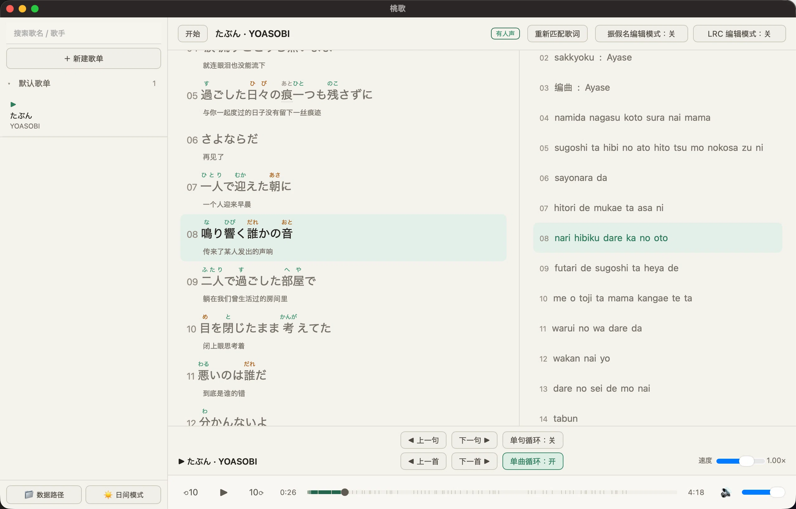
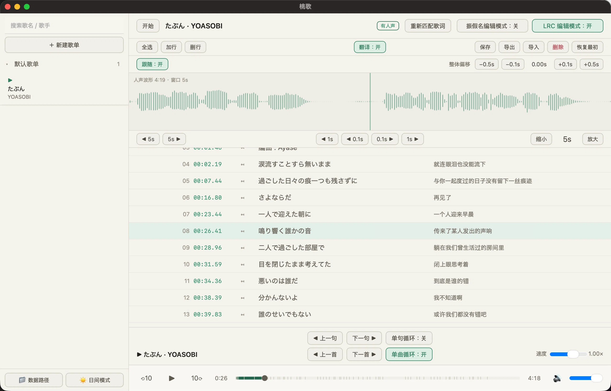

<p align="center">
  
</p>

<h1 align="center">桃歌 · momo uta</h1>

<p align="center">
  日文歌词标注与练习播放器
  <br>
  macOS · 本地运行 · Apple Silicon
</p>

<p align="center">
  
  <br><br>
  
</p>

## 它是什么

桃歌（momo uta）是一个本地日文歌曲播放器。

它把**播放、歌词、注音、翻译、时间轴编辑**放在同一个窗口里：

```text
听歌
  → 看振假名和罗马音
  → 改读音
  → 改 LRC 时间轴
  → 逐句循环练习
```

歌词和歌单默认保存在本机，不上传。

歌词文档使用 nhlrc 单一行模型：

```text
lyric / blank / metadata 统一为 rows
播放视图按时间从 rows 派生
只使用 nhlrc；所有写入都是 nhlrc
```

## 功能

### 播放

```text
播放 / 暂停 / 拖动 / 倍速
逐句高亮
单句循环
播放模式：列表循环 / 单曲循环 / 随机播放
全局快捷键
关闭窗口后继续播放
```

### 歌词

```text
振假名
罗马音
歌词翻译
逐句读音编辑
网易云歌词自动匹配 / 手动重新匹配
```

### LRC 编辑

```text
时间轴编辑
拆行 / 合并行
多选删除
撤销 / 重做
自动保存
导入 / 导出
备份 / 恢复最初
禁用歌词
翻译列
```

### 曲库

```text
歌单
导入音乐（只收音频）
导入音乐+LRC（显式允许本地歌词配对）
已有 nhlrc 优先
整体偏移
```

### 人声

```text
人声分离
纯音乐判定
人声轨波形
任务取消
```

### 界面

```text
日间 / 夜间模式
数据路径入口
快捷键帮助
```

## 三种版本

| 版本 | 人声分离 | 体积 | 适合 |
|---|---|---|---|
| **base** 基础版 | 不含 | ~230 MB | 只播放、编辑歌词 |
| **thin** 薄壳版 | 使用外部 demucs | ~230 MB | 自己装过 demucs |
| **full** 完整版 | 内置 demucs + torch + ffmpeg | ~859 MB | 开箱即用，推荐 |

三个版本**共享同一份用户数据**，切换版本不会复制歌单和歌词。

```text
base / thin / full 同时只建议运行一个。
```

## 安装

当前仓库可以构建 `.app`，但还没有签名、公证的正式发行包。

本地构建后：

```text
dist/base/momo-uta-base.app
dist/thin/momo-uta-thin.app
dist/full/momo-uta-full.app
```

使用步骤：

```text
1. 解压
2. 把 .app 拖进 Applications
3. 第一次打开：右键 → 打开
```

```text
当前构建未签名，macOS 可能提示无法验证开发者。
当前只提供 Apple Silicon（arm64）构建。
```

## 首次使用

```text
1. 打开应用
2. 导入歌曲或选择音乐目录
3. 等待歌词匹配
4. 点“开始”
```

如果歌曲没有歌词：

```text
可以在歌曲上点“重新匹配歌词”
或先导入本地 .lrc / .nhlrc
```

## 数据位置

底栏的 **📁 数据路径** 会直接用 Finder 打开当前数据目录。

```text
~/Library/Application Support/momo uta/data/
```

主要内容：

```text
lyrics/     歌词与备份
curated/    歌单、offset、导入记录
cache/      可重建缓存、app.log
vocals/     人声分离结果
config.json 本机配置
```

```text
开发版打开的是项目里的 data/。
打包版打开的是 Application Support 里的 data/。
```

## 快捷键

| 快捷键 | 作用 |
|---|---|
| `Space` | 播放 / 暂停 |
| `←` / `→` | 上一句 / 下一句 |
| `⌃⌥←` / `⌃⌥→` | 上一首 / 下一首（全局） |
| `⌃⌥P` | 播放 / 暂停（全局） |
| `L` | LRC 编辑模式 |
| `?` | 快捷键帮助 |

完整快捷键在应用内按 `?` 查看。

## 源码运行

要求：

```text
macOS 12+
Python 3.11+
Node.js（跑前端测试时需要）
```

```bash
python3 -m venv .venv
.venv/bin/pip install -e .
make app
```

人声分离可选：

```bash
.venv/bin/pip install -e '.[vocals]'
```

还需要系统里有 `ffmpeg`。

## 构建

```bash
.venv/bin/pip install pyinstaller

./packaging/build.sh base
./packaging/build.sh thin
./packaging/build.sh full
```

产物：

```text
dist/<variant>/momo-uta-<variant>.app
```

## 测试

```bash
make test
```

包含：

```text
Python 架构检查
Python 单元测试
前端语法 / 状态测试
```

单独运行：

```bash
make arch
make test-python
```

## 已知限制

```text
只提供 arm64 构建
未签名 / 未公证
没有自动更新
歌词来源目前只有网易云
full 首次人声分离需要下载模型
thin 需要外部安装 demucs / ffmpeg
三个版本共享用户数据
```

## 网络

应用本身在本机运行。以下功能会联网：

```text
网易云歌词匹配 / 候选
人声模型下载（full / thin）
```

用户歌词、歌单、offset 不上传。

## 文档

```text
docs/architecture.md          分层、数据归属、模块边界
docs/topics/nhlrc.md          歌词文件格式
docs/topics/cache.md          缓存与持久化
docs/topics/fingerprint.md    音频指纹
docs/topics/lyrics-matching.md 歌词匹配
docs/topics/player-state.md   播放器状态
docs/topics/lrc-editor.md     LRC 编辑器
docs/topics/audio.md          音频引擎
docs/topics/vocals-jobs.md    人声与 job
docs/topics/library.md        曲库、歌单、导入
docs/topics/http-api.md       本机 HTTP API
docs/topics/development.md    开发与测试
docs/topics/packaging.md      打包
docs/歌词数据模型.md           单一行模型
docs/代码审查.md               待处理代码问题
docs/优化.md                   待评估优化
```
